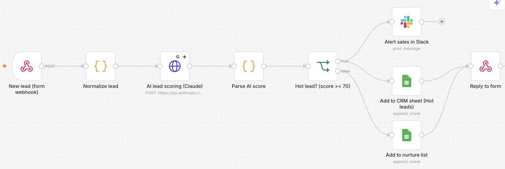

# LeadFlow: AI lead scoring and routing in n8n

An n8n workflow that qualifies every inbound lead with AI in seconds and routes it to the right place, so sales only spends time on leads worth calling.



## What it does
1. **Captures** a lead from any website form, Typeform, Webflow or landing page through a webhook.
2. **Normalizes** the data: trims fields, splits names, parses company size, and flags free email providers versus business domains.
3. **Scores** the lead 0-100 with Claude (`claude-opus-5-5`) using structured JSON output: score, intent, a one-line summary and a recommended next step.
4. **Routes** it:
   - **Hot leads (70+)**: instant Slack alert to sales with the summary and next step, plus a row in the CRM sheet
   - **Everyone else**: added to a nurture list for email follow-up
5. **Replies** to the form so the visitor gets an instant confirmation.

## Built to run unattended
- Retries the AI call up to 3 times; if it still fails, a **rule-based fallback score** kicks in, so no lead is ever dropped
- Server-side refusal fallback enabled on the Claude call
- Structured outputs guarantee valid JSON, so there's no fragile text parsing
- Each step is a small, named node, so a non-developer can follow and adjust it

## Setup
1. In n8n, go to **Workflows → Import from file** and choose `leadflow.workflow.json`.
2. Add credentials:
   - **AI lead scoring**: Header Auth credential with name `x-api-key` and your Anthropic API key as the value
   - **Slack**: connect your workspace and pick the channel
   - **Google Sheets**: connect your account and paste your sheet URL (tabs: `Hot leads`, `Nurture`)
3. Activate the workflow, then send a test lead:
   ```bash
   ./test-lead.sh https://your-n8n-host/webhook/lead
   ```

## Customizing
- Change the scoring criteria in the system prompt inside `build.py` (or directly in the HTTP Request node)
- Swap Google Sheets for HubSpot, Pipedrive or Airtable, or Slack for email/Teams
- Change the hot-lead threshold in the **Hot lead?** node

## Files
```
leadflow.workflow.json   importable n8n workflow
build.py                 generates the workflow JSON from the node code
nodes/                   JavaScript for the Code nodes (unit-testable outside n8n)
test-lead.sh             sends a sample lead to the webhook
```
